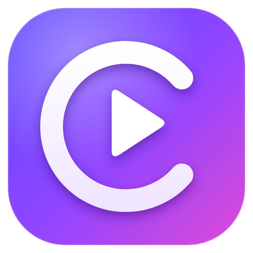
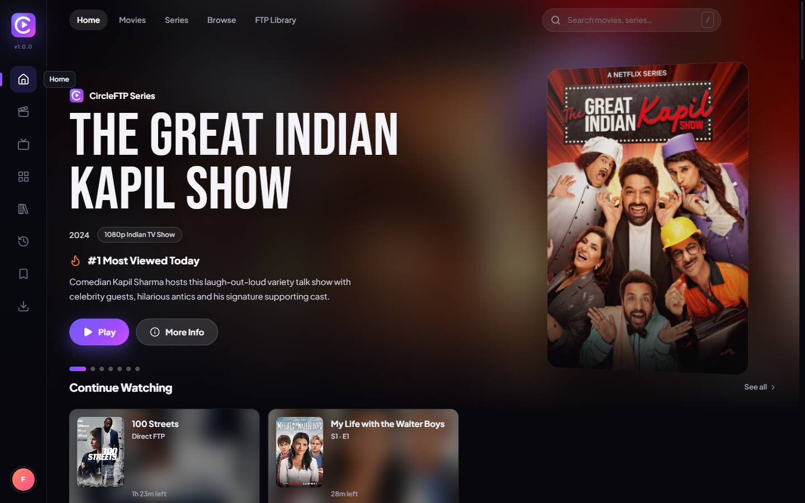
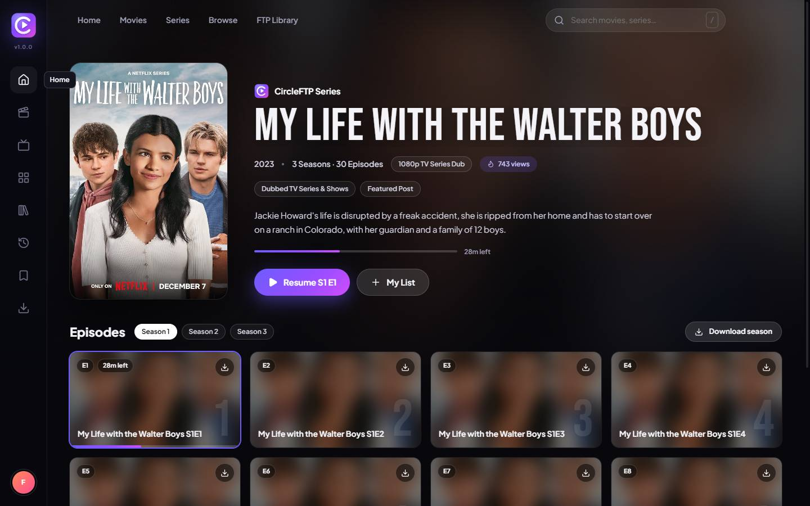
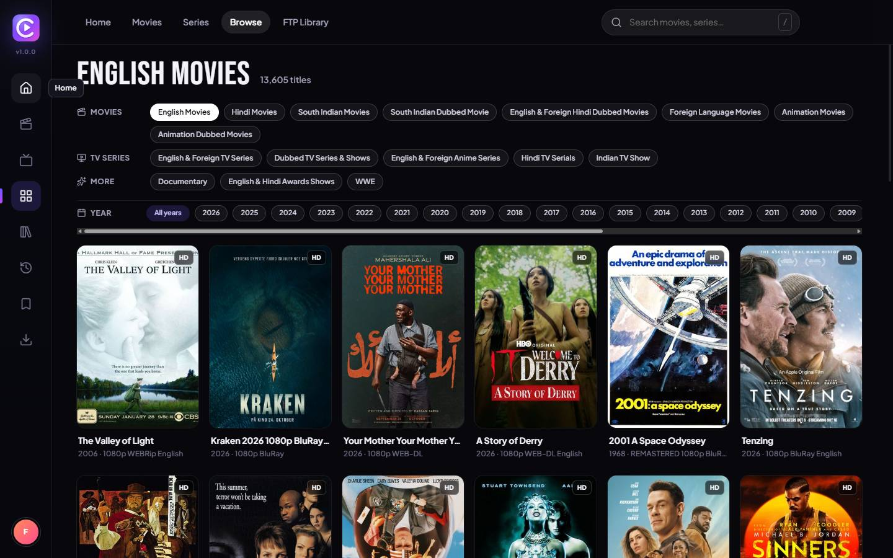
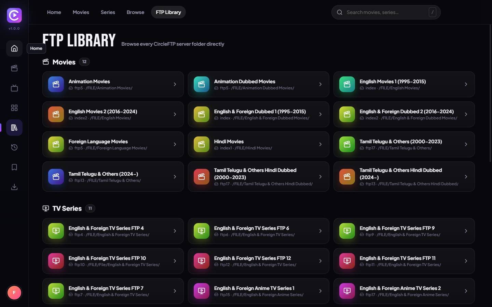
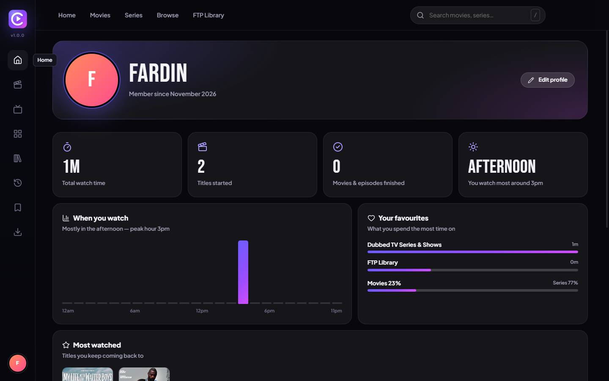
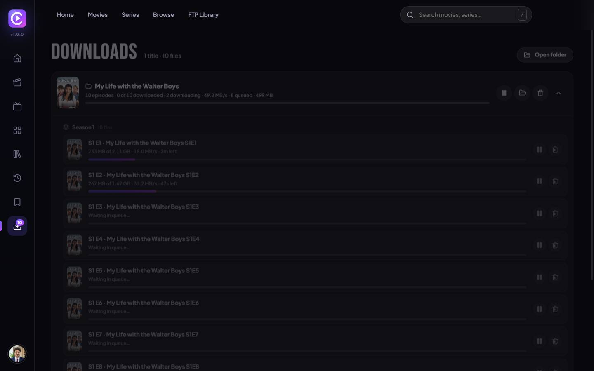
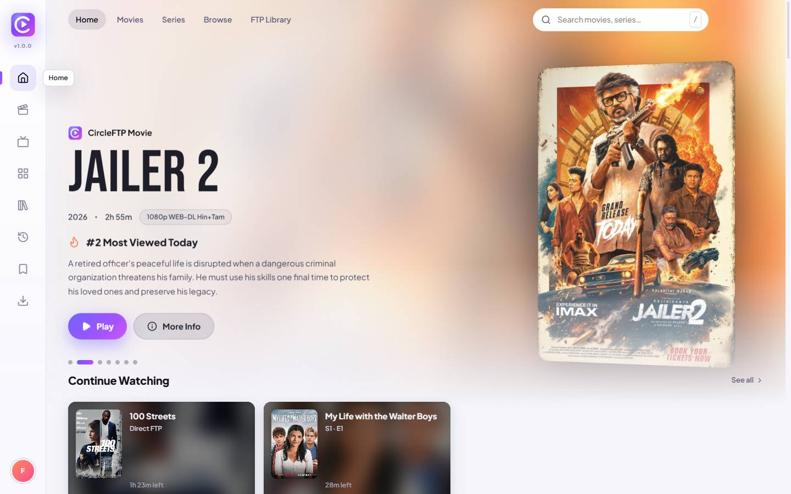

<div align="center">
  
  <h1>CircleFlix</h1>
  <p><b>A streaming-style desktop app for the CircleFTP media servers.</b><br>
  Browse, play, resume and download — with the feel of a modern streaming service.</p>

  <a href="https://github.com/fardinahosancse/circleflix/releases/latest"></a>
  <a href="https://github.com/fardinahosancse/circleflix/actions/workflows/release.yml"></a>
  
  
</div>



> **Unofficial project.** CircleFlix is not affiliated with Circle Network. It is only a player for
> the servers your connection can already reach — it works on the CircleNetwork (BDIX) connection only
> and hosts no content itself.

## Download

Get the latest build from the **[Releases page](https://github.com/fardinahosancse/circleflix/releases/latest)**:

| File | Use it when |
| --- | --- |
| `CircleFlix-Setup-x.y.z.exe` | You want it installed with a Start-menu shortcut |
| `CircleFlix-Portable-x.y.z.exe` | You want a single file that runs without installing |

Windows may show a SmartScreen warning because the app is not code-signed: choose **More info → Run anyway**.
FFmpeg is bundled — nothing else to install.

## Features

**Watch**
- Home page with trending titles, fresh uploads, per-category rows and **Continue Watching**
- Movies, Series and Browse pages — only video categories, filterable by year
- **FTP Library**: every CircleFTP server folder ("Direct Link" on the website) browsable as a poster grid,
  with filter and sorting
- Search across the whole catalog

**Player**
- Plays MKV/MP4 with Dolby (EAC3/AC3), DTS and HEVC — files a normal browser cannot play
- Switch **audio language** and **subtitles** (embedded and `.srt` files next to the video), three subtitle sizes
- Seek anywhere, playback speed, next-episode countdown, fullscreen, keyboard shortcuts
- Live **download speed** and how much is **cached ahead**
- **Mini player**: minimise the video to a corner and keep browsing; click to expand

**Yours**
- Watch **history** with progress bars and resume, plus **My List**
- **Offline downloads**: single files, a whole season, or a whole FTP folder in one click
  - two files download at a time, the rest wait in a queue; pause and resume any time
  - saved in tidy folders: `Downloads/Circle Download/<Title (Year)>/<Season>/<file>`
  - the Downloads page shows one expandable folder per title with its seasons inside and a combined progress line
  - finished files play from disk, even with no connection
- **Profile**: first launch asks for your name (required) and a picture (optional, with a built-in
  cropper); the profile page shows total watch time, the time of day you watch most, favourite
  categories and most watched titles
- **Dark and light** themes

**App**
- Opening animation, app version shown under the logo, About section with developer, repository and bug-report links
- Clear errors when a server is offline or a file was removed
- The window is either the default size or maximised/fullscreen — it cannot be dragged to odd sizes

| Title page | Browse |
| --- | --- |
|  |  |

| FTP Library | Profile |
| --- | --- |
|  |  |

| Downloads | Light theme |
| --- | --- |
|  |  |

## Keyboard shortcuts

| Key | Action | Key | Action |
| --- | --- | --- | --- |
| `Space` / `K` | Play / pause | `F` | Fullscreen |
| `←` / `→` | Back / forward 10 s | `M` | Mute |
| `↑` / `↓` | Volume | `C` | Audio & subtitles |
| `N` | Next episode | `I` | Mini player |
| `/` | Search | `Esc` | Back |

## Run from source

Requires [Node.js](https://nodejs.org) 20 or newer.

```bash
git clone https://github.com/fardinahosancse/circleflix.git
cd circleflix
npm install
npm start
```

Build the Windows installer and portable exe into `dist/`:

```bash
npm run dist
```

## How it works

- **Catalog** — the same JSON API the website uses (`new.circleftp.net:5000/api`): home rows, categories,
  search, and per-title file links.
- **FTP Library** — the index servers (`ftpN.circleftp.net`, `index*.circleftp.net`) publish plain HTTP
  directory listings; the app parses them and matches folder names to catalog posters.
- **Playback** — most files use audio codecs Chromium cannot decode. A local gateway
  ([`src/main/media.js`](src/main/media.js)) runs FFmpeg: video is passed through untouched, the selected
  audio track is converted to AAC, and the result is streamed to the player as fragmented MP4.
  Subtitles are extracted to WebVTT. Video is re-encoded only when the original cannot be decoded.
- **Data** — history, list, profile, stats and settings live in one JSON file in the app's user-data folder.
  Nothing leaves your computer.

```
src/main/       Electron main process: API client, FFmpeg gateway, downloads, storage
src/renderer/   UI: pages, player, library, profile/downloads
build/          App icon (SVG source + generated PNG/ICO)
```

## Releasing

Pushing a tag `vX.Y.Z` runs [the workflow](.github/workflows/release.yml), which builds the Windows
installer and portable exe and attaches them to a GitHub Release.

## Changelog

See [CHANGELOG.md](CHANGELOG.md).

## Bugs and feedback

Found a problem? **[Open an issue](https://github.com/fardinahosancse/circleflix/issues)** — include the
title you were watching and what happened.

## Credits

- Developer: **[S.M.Fardin Ahosan](https://github.com/fardinahosancse)**
- Icons: [Lucide](https://lucide.dev) (ISC)
- Media engine: [FFmpeg](https://ffmpeg.org). Release builds bundle FFmpeg binaries (GPL) from the
  `ffmpeg-static` and `ffprobe-static` packages; they run as separate programs.

## License

[MIT](LICENSE) for the CircleFlix source code.
